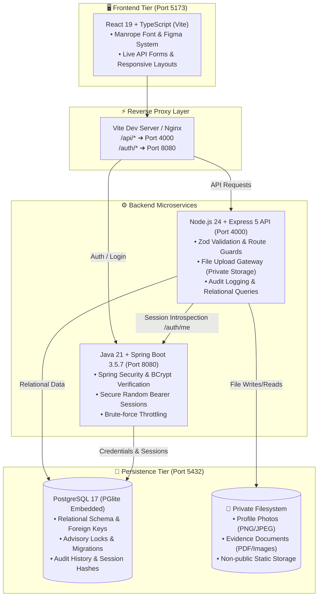
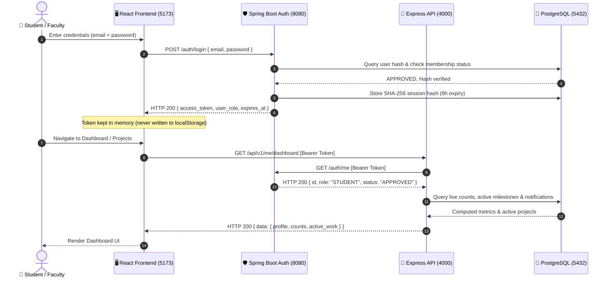
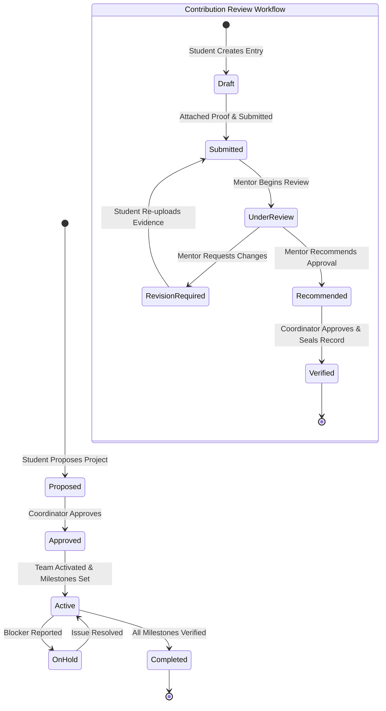

<div align="center">

# 🚀 Prathyusha FinTech — Student Portal
### Enterprise Full-Stack Student Workspace & Academic Contribution System

[](https://react.dev/)
[](https://www.typescriptlang.org/)
[](https://nodejs.org/)
[](https://expressjs.com/)
[](https://spring.io/projects/spring-boot)
[](https://www.postgresql.org/)
[](https://vitejs.dev/)

<p align="center">
  <b>Student Dashboard</b> • <b>Profile & Privacy</b> • <b>Projects & Tasks</b> • <b>Activity Summary</b> • <b>Evidence Verification</b>
</p>

---

</div>

## 📌 Executive Summary

This repository delivers the complete, production-ready full-stack solution for **Priyan's assigned modules**:
- 📊 **Student Dashboard:** Real-time metrics, active projects, next milestone countdown, weekly updates, and unread notifications.
- 👤 **Profile & Privacy:** Profile details, academic year, skills/interests, portfolio links, and privacy consent toggle.
- 📁 **Projects & Tasks:** Propose projects, coordinator approval workflow, member assignment, milestone tracking, and task Kanban boards.
- 📈 **Personal Activity Summary:** Date-filtered activity breakdown, work-area distribution, verified achievements, and CSV export.
- 🛡️ **Contributions & Evidence:** Draft contributions, upload private evidence (PNG/JPEG/PDF up to 5 MiB), and multi-tier verification.

---

## 🏗️ System Architecture & Data Flow



---

## 🔐 Authentication & Session Handshake



---

## 🔄 Contribution & Project Lifecycle Workflow



---

## ⚡ Quick Start on Windows

### Option 1: 1-Click Native Runner (Recommended — No Docker Required)

Everything is preconfigured with embedded PostgreSQL and native Spring Boot:

```powershell
# 1. Start all services (Database, Auth, API, Frontend):
.\run-all.ps1
```

```powershell
# 2. Stop all services and free all ports anytime:
.\stop-all.ps1
```

> [!TIP]
> Once launched, open **[http://localhost:5173](http://localhost:5173)** in your browser.

---

### Option 2: Docker Compose

```powershell
# 1. Copy environment template
Copy-Item .env.example .env

# 2. Launch multi-container stack
docker compose up --build -d
```

Open **[http://localhost:8088](http://localhost:8088)** for the Nginx-hosted production bundle.

---

## 👥 Default Seeded Accounts

The development runner automatically sets up three institutional roles:

| Role | Email | Password | Privileges |
|---|---|---|---|
| 🎓 **Student** | `priyan@prathyusha.edu.in` | `Student123!` | Propose projects, update tasks, submit evidence, manage profile |
| 📋 **Coordinator** | `coordinator@prathyusha.edu.in` | `Admin123!` | Approve proposals, verify contributions, manage identity corrections |
| 🧑‍🏫 **Mentor** | `mentor@prathyusha.edu.in` | `Mentor123!` | Review assignments, guide projects, recommend student submissions |

---

## 🌐 Port & Endpoint Directory

| Service | Protocol / Port | Health Check / Probe | Description |
|---|---|---|---|
| **React Web App** | `http://localhost:5173` | Browser ready | Frontend Vite application with reverse proxy |
| **Node Express API** | `http://localhost:4000` | `http://localhost:4000/health/ready` | Core REST APIs (`/api/v1`) |
| **Spring Auth Service** | `http://localhost:8080` | `http://localhost:8080/health` | Spring Security auth provider (`/auth`) |
| **PostgreSQL Database** | `tcp://127.0.0.1:5432` | Socket connection | Relational storage & schema |

---

## 🧪 Terminal Verification Script

You can verify the entire API pipeline directly in PowerShell:

```powershell
# 1. Authenticate and retrieve bearer token
$login = Invoke-RestMethod -Method Post -Uri "http://localhost:5173/auth/login" `
  -ContentType "application/json" `
  -Body '{"email":"priyan@prathyusha.edu.in","password":"Student123!"}'

Write-Host "✅ Logged in successfully! Token:" $login.access_token.Substring(0, 12)...

# 2. Query Student Dashboard through the proxy
$headers = @{ Authorization = "Bearer $($login.access_token)" }
$dash = Invoke-RestMethod -Uri "http://localhost:5173/api/v1/me/dashboard" -Headers $headers
$dash.data.profile | Format-List
```

---

## 📊 Feature Comparison Matrix

| Module | Features & Implementation Details |
|---|---|
| **Student Dashboard** | Profile greeting, live counts, active work cards, next incomplete milestone, imported weekly plan/feedback, recent activity, unread notification counter. |
| **Profile & Privacy** | Display name, bio, academics, skills, portfolio links, photo upload, version checks. Consent off by default; explicit coordinator approval required. |
| **Protected Identifiers** | Full name, register number, and email require formal correction requests reviewed and approved by administrators. |
| **Access Control** | Approved membership validation, role guards, project membership verification, file ownership permissions. |
| **Projects & Tasks** | Proposal workflow, coordinator review, assigned lead/mentor roles, milestone tracking, blocker tracking, and task state transitions. |
| **Contributions** | Draft, evidence attachment (PNG/JPEG/PDF), submit, mentor recommendation, coordinator verification. |
| **Summary & Export** | Date-filtered counts, work-area breakdown, submitted vs. verified distinction, CSV export, sync freshness indicator. |

---

## 🧩 External Team Module Integration

Weekly updates, hackathon registrations, and digital magazines remain owned by their respective team members. Data feeds into this student dashboard through an **idempotent admin endpoint**:

```http
PUT /api/v1/admin/integrations/activities/{source}/{externalId}
```

```json
{
  "user_id": "4350c61b-182a-4a2d-b6ef-8ef81b60adc8",
  "project_id": "0d8bb094-d213-4f87-9620-4df1fb834b4f",
  "kind": "HACKATHON",
  "status": "VERIFIED",
  "title": "Smart India Hackathon 2026",
  "occurred_on": "2026-03-15"
}
```

---

## 🛡️ Security & Privacy Guarantees

> [!IMPORTANT]
> **No Fabricated Data or Fake AI Scores:** Dashboard counters and activity metrics are computed strictly from real database records. There is no synthetic LLM score or fabricated summary.

> [!CAUTION]
> **Private Evidence Storage:** Uploaded student files and certificates are stored in a private directory with size and signature validation. They are never exposed as public static folders.

---

## 📂 Project Structure

```
Prathyusha_FinTech_Student_Portal/
├── api/                  # Express 5 REST API source, tests & validation
│   ├── src/              # app.js, db.js, migrate.js, standalone-runner.js
│   └── test/             # 15 automated integration tests
├── auth/                 # Spring Boot 3.5.7 source & Maven pom.xml
├── db/                   # PostgreSQL schema migrations (001_schema.sql)
├── docs/                 # API documentation, Figma mappings & test logs
├── frontend/             # React 19 + TypeScript + Vite web application
│   ├── src/              # Components, pages, routing, state, styles
│   └── dist/             # Production distribution build
├── runtime/              # Compiled fintech-auth-1.0.0.jar & persistent pgdata
├── run-all.ps1           # 1-Click launcher script
└── stop-all.ps1          # 1-Click shutdown script
```

---

<div align="center">
  <sub>Prathyusha Engineering College — FinTech Innovation Team Student Portal</sub>
</div>
